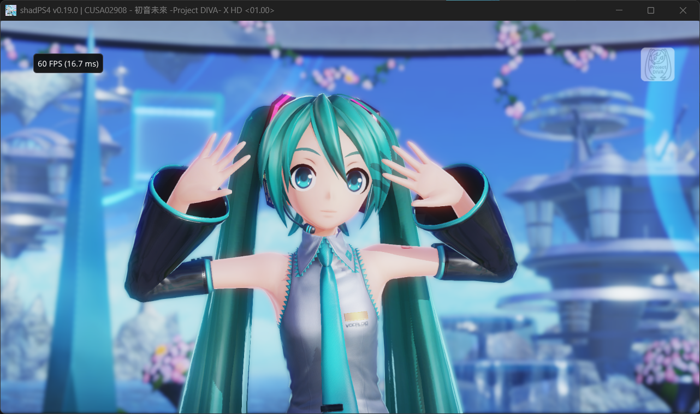
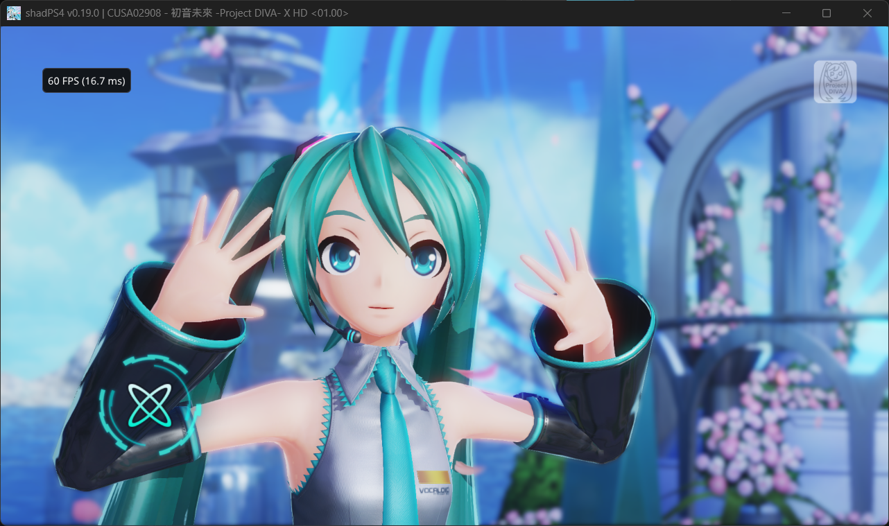
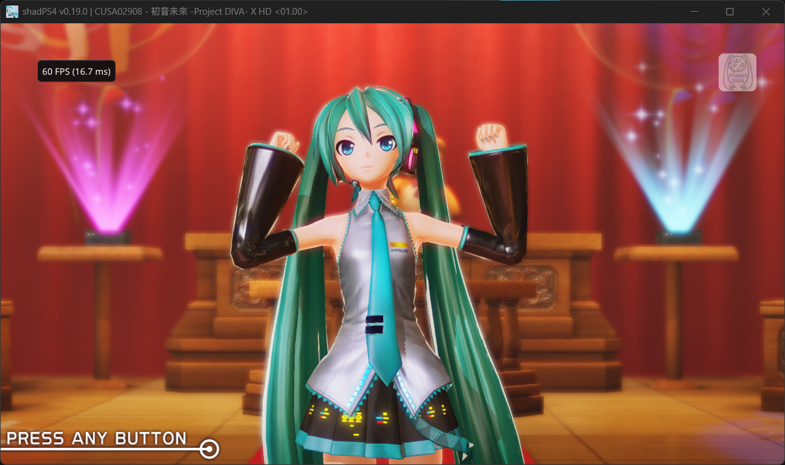

# XHD-Player

为《初音未来 -Project DIVA- X HD》CUSA02908 01.00 制作的 Windows 专用运行环境，采用修改后的 shadPS4 核心运行原版 PS4 游戏程序。目标是减少玩家配置步骤，并修复此游戏遇到的启动、光照回读和性能问题。

仓库与运行包目录均为 **XHD-Player**。这是非官方的游戏专用兼容运行时，尚不是完整的原生 PC 重写版。

## 下载与开始游戏

从 [Releases](https://github.com/kijwt133/XHD-Player/releases) 下载：

| 文件 | 内容 |
|---|---|
| `XHD-Player-template-v0.1.1.zip` | 纯净启动环境模板，不含核心 EXE；需要自行构建或提供匹配核心 |
| `XHD-Player-source-v0.1.1.zip` | 对应核心的完整源代码、依赖源树、补丁、构建脚本 |
| `SHA256SUMS.txt` | 下载文件校验值 |

**公开下载包不包含核心 EXE、游戏、Sony 系统模块、密钥、个人存档或已生成的缓存。** 带核心的 `XHD-Player-windows-v0.1.0.zip` 仅保留在维护者本地，不作为 GitHub 附件发布。本机测试使用过自备系统模块；公开版需要使用者自行构建或提供匹配核心，并准备必要模块，不能仅凭解压模板开始游戏。

1. 解压纯净模板到自己可写的目录，按照 [BUILDING.md](BUILDING.md) 构建核心，将输出 EXE 放到 `core/XHD-Runtime.exe`。模板默认校验本地测试核心的哈希，自行编译后需将 `package.json` 的 `core_sha256` 及 `required_files` 中核心项的 `sha256` 更新为自己构建的可信 EXE 哈希。
2. 将自己的完整游戏文件夹放入 `game/CUSA02908/`，确认下方结构。不要套两层 CUSA02908 文件夹。
3. 按 [REQUIRED-MODULES.md](REQUIRED-MODULES.md) 提供兼容系统模块，放入 `runtime/user/sys_modules/`。
4. 可先双击 `Check-Runtime.cmd` 校验文件；再双击 `Start-XHD.cmd` 启动。

```text
XHD-Player/
  Start-XHD.cmd
  Check-Runtime.cmd
  Edit-KeyBindings.cmd
  Open-Saves.cmd
  core/XHD-Runtime.exe
  game/CUSA02908/
    eboot.bin
    rom/...
    sce_module/...
    sce_sys/param.sfo
  runtime/user/sys_modules/    # 自行提供的系统模块
  runtime/user/home/1000/savedata/  # 运行后产生的存档
  launcher/
  logs/
```

运行不需要 Python、编译器或另一套 shadPS4。需要 64 位 Windows、Windows PowerShell，以及支持 Vulkan 的显卡驱动。当前实测环境为 Windows 11、RTX 4060；尚未建立其他硬件的兼容性矩阵。核心使用 Windows 内存占位 API，旧系统支持情况需自行验证。

首次启动会生成图形缓存，终端会显示进程运行时间；这不是精确的加载百分比。等待游戏窗口出现。窗口关闭后，存档和设置仍保存在包内。整体移动目录即可保留这些数据。

## 键位与存档

默认面键：`W=△`、`D=○`、`S=×`、`A=□`；小键盘 `8/6/2/4` 也可用。`Enter` 为 Options，`Space` 为触摸板，方向键为十字键。`F8` 重载键位、`F11` 全屏、`F9` 暂停、`F3` 设置。

双击 `Edit-KeyBindings.cmd` 编辑 `runtime/user/input_config/default.ini`。初次编辑前会保留一份备份；完整摇杆和肩键映射见包内 `键位说明.txt`。

默认玩家编号为 `1000`。存档位于 `runtime/user/home/1000/savedata/CUSA02908/savedata0/`，主文件为 `savefile01`。`Open-Saves.cmd` 打开目录和说明。替换自己的存档前先退出游戏，并另存整个 CUSA02908 存档文件夹。`sce_backup` 是会自动更新的备份，不应作为唯一备份。PS4 导出的加密包不能直接复制使用；需要相同游戏的兼容明文存档，实际读取兼容性需进入游戏检查。

## 当前实现与验证边界

- 宿主互斥函数使用独立宿主栈，处理此游戏启动阶段的栈兼容问题。
- 小图像曝光反馈批量回读，保留同步 CPU 可见性，避免全场景线性图像回读带来的性能下降。
- Windows 物理内存 backing 保留原始地址布局，改为按游戏实际映射区域提交，避免启动时一次申请 8.25 GiB 提交额度。
- 所有配置、存档、缓存和日志使用包内独立目录；启动器校验核心、游戏关键文件与系统模块。
- 启动器用 Windows Job Object 管理自己启动的进程，限时测试静音，退出后清理自己的游戏进程。

详细机制、配置和证据边界见 [IMPLEMENTATION.md](IMPLEMENTATION.md)，构建与对应源码见 [BUILDING.md](BUILDING.md)。

使用者已反馈修复后局内亮度和 FPS 恢复正常；以下为使用者提供的实际运行截图，叠加计数器显示 60 FPS。截图不代表所有歌曲、所有硬件或完整游玩流程都已验证。最新内存改动另通过 60 秒静音启动测试：加载到开场视频，没有复现原内存分配断言；没有通过该测试重新验证全部局内光照和帧率。

## 效果图







图片由项目使用者提供，保留原始画面和 FPS 叠加层；游戏及角色版权归各自权利人。图片是运行效果展示，不随包分发游戏资源。

## 来源、灵感与许可

核心直接基于 [shadPS4](https://github.com/shadps4-emu/shadPS4)，固定源提交 `c7e065d1b415be16c23e260a21f1dd8bbfc4cb57`（0.19.0 开发基线）。PS4 服务、加载器、图形和输入等基础能力来自 shadPS4 及其依赖项目。本仓库保留其版权与许可证。

[bbport](https://github.com/Yharnam-Hunters/bbport) 提供了围绕单一游戏收敛运行环境和兼容问题的思路，研究参考提交 `8a2ed0ec9170b924e83708da0432e59ae70eeadf`。这里没有把 Bloodborne 的专用补丁套到 X HD 上，也不依赖 bbport 运行；X HD 的回读、内存和启动适配在 shadPS4 的对应路径中实现。

本项目与 SEGA、Sony、shadPS4 或 bbport 团队没有官方合作或背书。修改核心及本项目代码按 GPL-2.0-or-later 发布；依赖和字体按其各自许可证发布，见 `LICENSE`、`licenses/` 及完整源码包。游戏、系统模块和截图中的角色不属于 GPL 授权范围。

请自行准备自己有权使用的游戏与系统模块，不要在 Issue、提交或附件中上传游戏程序、系统模块、密钥、账号信息或个人存档。

## 排错

文件缺失或校验失败：按终端提示检查具体文件。当前启动器严格匹配本机测试的 CUSA02908 01.00 关键文件和模块版本，不承诺其他地区或更新版本兼容。

运行中系统资源不足：按需提交减少了启动额度，但游戏实际使用的内存仍需要系统提供；关闭不用的程序后重试。启动慢可检查 `logs/last-run.json` 和对应游戏日志。日志可能带本机路径，提交 Issue 前请删去个人信息。

不要用慢速的全量回读方案替换默认配置。默认关闭 buffer readbacks、开启 linear image readbacks，并由专用小图像批量回读分支处理曝光反馈。

报告问题时提供系统、显卡、驱动、歌曲/场景、可复现步骤，以及脱敏日志。不要只以截图瞬时 FPS 推断整段性能。
